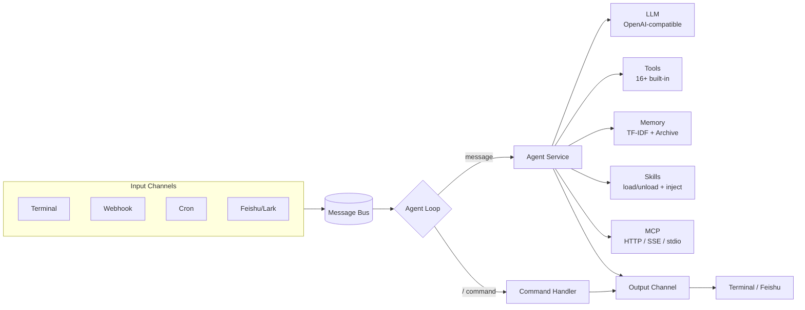

[Documentation](index.md) · [简体中文](../zh/architecture.md)

# 🏗️ Architecture



### Project structure

```
|- .lemonclaw/    LemonClaw core config storage
|--- .env         Environment variables
|--- .env.example Example env file
|--- mcp.json     MCP server config (HTTP / SSE / stdio; gitignored - contains secrets)
|--- lemonclaw.db Global SQLite3 database (single DB for the whole project)
|- agent/         Agent implementation (loop, tools, LLM, memory, skills, MCP)
|- channels/      Input/output devices and the message bus
|- dao/           Database models and DAO operations
|- config/        Configuration
|- tests/         Unit tests
|- loop.py        Agent loop core
|- main.py        Entry point
```
