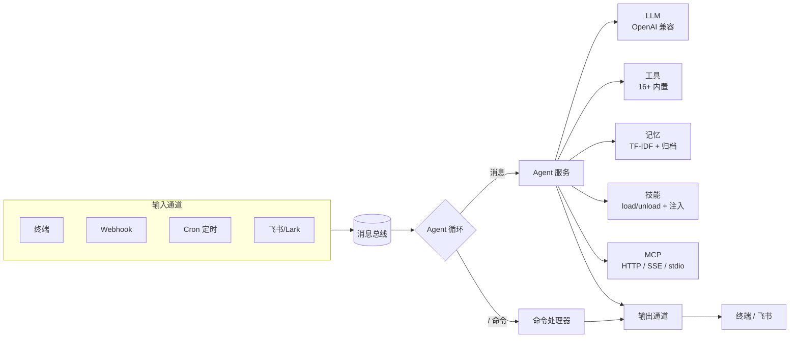

[文档首页](index.md) · [English](../en/architecture.md)

# 🏗️ 架构



### 项目结构

```
|- .lemonclaw/    LemonClaw 核心配置存储目录
|--- .env         环境变量配置文件
|--- .env.example 环境变量配置样例文件
|--- mcp.json     MCP 服务端配置（HTTP / SSE / stdio；含密钥，已 gitignore）
|--- lemonclaw.db 全局 SQLite3 数据库（整个项目仅此一个库）
|- agent/         Agent 实现模块（循环、工具、LLM、记忆、技能、MCP）
|- channels/      输入输出设备和通道、消息总线
|- dao/           数据库 model 和 dao 操作模块
|- config/        配置相关代码模块
|- tests/         单元测试目录
|- loop.py        Agent Loop 核心代码
|- main.py        启动入口代码
```
